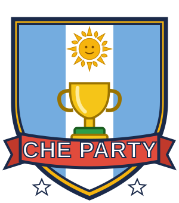

<p align="center"></p>

# Che Party 🧉

Party game argentino estilo "juego de tablero + minijuegos". La tele muestra el juego en 3D
y cada jugador usa **su celular como control** (sin instalar nada: entra por el navegador).
Funciona **sin internet**: solo hace falta que la PC y los celus estén en el mismo wifi.

## Cómo jugar

1. Doble clic en **`dist/CheParty.exe`**. Se abre solo la pantalla del juego.
   - No hace falta instalar nada: el `.exe` trae todo adentro.
   - Si Windows muestra "Windows protegió su PC", tocá **Más información → Ejecutar de todas formas** (pasa con cualquier programa que no está firmado).
   - Si Windows pregunta por el firewall, tocá **Permitir** en redes privadas (si no, los celus no pueden entrar).
   - **No cierres la ventana negra** mientras juegan: es el servidor del juego.
2. Poné la pantalla en la tele. Al tocar **¡Empezar!** se pone sola en pantalla completa (también con la tecla **F**). Tocá la pantalla o una tecla para activar el sonido.
   - **P**: pausa (en la tele y en los celus aparece "Pausa"; todo queda congelado, incluso a mitad de un minijuego). Con **P** o un clic se sigue.
   - **M**: silencio (se acuerda para la próxima vez).
   - La pantalla de la compu no se apaga sola mientras el juego está abierto.
3. Cada jugador **escanea el QR** con el celu, pone su nombre, **elige su personaje** y toca **LISTO**.
4. **En la compu** (con el mouse, en la pantalla de la tele) se elige todo lo de la partida: **tablero**, **modo**, rondas o Copas, bots (sumar, sacar) y sacar jugadores. Cuando todos tocaron LISTO: **¡Empezar!**

El celu es solo el control: elegir personaje, LISTO, tirar el dado, elegir en los cruces, el kiosco, los regalos y jugar los minijuegos. Toma el color de tu personaje.

Alternativa sin `.exe` (si tenés Node.js instalado): doble clic en `Iniciar Che Party.bat`.

### Si lo bajaste de GitHub

El `.exe` no se sube al repositorio (pesa más de 80 MB). Para armarlo hace falta [Node.js](https://nodejs.org) 22 o más nuevo:

```bash
npm install
npm run exe
```

Queda en `dist/CheParty.exe`. Para jugar sin armar el `.exe`: `npm start` y abrir `http://localhost:3000/tv`.

## Modos

- **Por rondas** (como el original): de 8 a 50 rondas (8, 12, 16, 20, 30, 40 o 50) para partidas largas. Gana el que tiene más Copas al final.
  - Faltando 3 rondas: **¡Últimas 3 rondas!** Las casillas valen el doble y el que viene último recibe 10 mangos.
  - Al final, **premios sorpresa** (+1 Copa cada uno): hay 21 y en cada partida salen 5 al azar (entre los que tienen un ganador claro). Para cada uno se ven las barras de todos con un redoble y después quién gana. Algunos: Rey del Minijuego, El Millonario, Mala Leche, El Caminante, Comprador Compulsivo, El Regalón, Dado de Oro, La Tortuga, El Duelista, El Turista, El Banquero, El Chorro, El Pechofrío…
  - Para cerrar, la cámara sube a un **podio entre las nubes**: los tres primeros en sus escalones, el ganador con la Copa arriba de la cabeza y papelitos, y al costado la tabla final.
- **Por Copas**: gana el primero que junta 1, 2, 3, 5, 7 o 10 Copas.
- **Solo minijuegos**: sin tablero. Desde la compu elegís qué minijuego jugar y en qué modo (todos, duelo, 2 vs 2 o 1 vs 3), o uno al azar. Cada victoria suma una Copa; con 🏁 Terminar se ve quién ganó. Sirve para probar los juegos.

## Tableros

Cada tablero tiene su forma:

| Tablero | Forma | Casillas | Cruces | Casilla especial |
|---|---|---|---|---|
| **Buenos Aires** | Cuadrícula de 3 x 2 manzanas con calles de mano única: se puede dar la vuelta a la manzana, cortar por Corrientes o Callao, o seguir por el borde (Costanera, Palermo, La Boca) | 80 | 5 esquinas: Palermo / 9 de Julio · Boedo / Abasto · Corrientes / Callao · El Bajo / Obelisco · Plaza de Mayo / Congreso | 🚌 Colectivo: tres paradas en línea circular, cada una te lleva a la siguiente |
| **Mendoza** | Sube a la Cordillera por los Caracoles (en zigzag, cada vuelta más alta) hasta el Cristo Redentor y baja por el Zonda | 76 | Caracoles / Ruta del Vino · Parque San Martín / Peatonal | 🌪️ Zonda: te lleva volando a cualquier casilla celeste. 🚌 El micro va de la Peatonal a la cumbre |
| **La Costa** | Larga y finita junto al mar: la Rambla va para un lado y la Avenida vuelve por el otro | 89 | Muelle (entra al mar y vuelve, con premios) / Playa · Puerto (la vuelta larga) / Faro · Torreón / Peatonal | 🌊 Ola: te empuja 4 casillas para adelante |
| **Bariloche** | Una vuelta alrededor del lago Nahuel Huapi; atrás se sube al Cerro Catedral (con la aerosilla y pinos nevados) | 70 | Cerro Catedral / Costanera del lago · Colonia Suiza / Llao Llao | 🏔️ Avalancha: te arrastra 3 casillas para atrás. ⛴️ El catamarán cruza el lago |
| **Córdoba** | Un ocho por las Sierras: la vuelta larga por Carlos Paz y el Uritorco, o el atajo en diagonal por La Cañada | 68 | Carlos Paz / La Cañada · Estancias Jesuíticas / Alta Gracia | 🛸 Ovni: te abduce y te deja en cualquier casilla celeste |
| **Sur (Ushuaia)** | El fin del mundo: el Canal Beagle, la pingüinera, el Cerro Martial y el Glaciar | 63 | Isla de los Pingüinos / Tren del Fin del Mundo · Glaciar / Parque Nacional | 🐧 Pingüinos: te llevan en trineo 3 casillas para adelante. 🚂 El Tren del Fin del Mundo es el atajo |
| **Norte (Salta y Jujuy)** | Zigzag por la Cuesta de Lipán hasta el altiplano: las Salinas Grandes o el viaducto del Tren a las Nubes | 62 | Salinas Grandes / Viaducto · Humahuaca / Purmamarca | 🌄 Pachamama: le ofrecés unos mangos y te hace un regalo. 🚂 El Tren a las Nubes |

## Reglas

- Al empezar, todos tiran el dado desde el celu: el que saca más arranca.
- Cada turno tirás el dado (1 a 10) y avanzás. En los **cruces** elegís por dónde seguir desde el celu.
- Casillas (cada tipo tiene su forma):
  - 🔵 **celeste** +3 mangos · 🔴 **roja** −3
  - ⭐ **evento** sorpresa (asado, aguinaldo, inflación…)
  - 🏪 **kiosco**: comprás ítems
  - 🚌 **colectivo / micro**: te lleva directo a la parada siguiente (¡pero no para en la Copa!)
  - 🏦 **banco**: si pasás, depositás 2 mangos; si caés, te llevás todo lo guardado
  - 🧾 **impuestazo**: te cobran el 30% de tus mangos (van al banco)
  - 🍀 **regalo de Sifón**: Sifón trae tres cajas y elegís una desde el celu. Hay una buena y una mala: mangos, ítems, "cumpleaños" (todos te regalan), un remís… ¡o una Copa! (muy de vez en cuando). Después se abren las otras para ver qué te perdiste.
- Cuando pasás por la **Copa 🏆** podés comprarla por 15 mangos. Después la Copa se muda a otra casilla y la cámara va hasta ahí para que todos vean dónde quedó (lo mismo al empezar la partida).
- **Noticias de último momento**: al empezar algunas rondas Sifón interrumpe con una noticia que cambia la partida (con placa roja de noticiero): lluvia de mangos, Robin Hood (el más rico le da al más pobre), inflación, la Copa se muda, oferta o remate de la Copa, sorteo de un ítem, revoleo general (todos cambian de lugar), impuesto al que va primero, duelo entre el primero y el último, feriado largo y apagón. Algunas tienen su versión en cada tablero.
- **Duelos**: si caés donde está otro jugador, lo podés retar a duelo. El que gana se lleva hasta 10 mangos del otro.
- Al final de cada ronda hay un **minijuego**. Con 4 jugadores, el color de la última casilla de cada uno (celeste o roja) arma los equipos:
  - **Todos contra todos**: 1° +10, 2° +6, 3° +3, 4° +1 mangos.
  - **2 contra 2**: el equipo que gana, +10 cada uno.
  - **1 contra 3**: si gana el que está solo, +15; si ganan los tres, +5 cada uno.
- Antes de cada minijuego podés **probar el control** en el celu y después tocás **¡Listo!**
- **Don Sifón**, el anfitrión, aparece en 3D y habla con su vocecita: presenta, se burla de las tiradas malas, festeja las Copas, avisa los cambios de puntero y comenta los minijuegos. En los momentos importantes sale grande.
- De 2 a 6 jugadores; los bots completan si faltan. Si un celu se desconecta, el juego juega por él hasta que vuelva.

### Ítems del kiosco (máximo 3)

El kiosco no tiene todo siempre: ofrece cuatro ítems al azar más el remís.

| Ítem | Precio | Qué hace |
|---|---|---|
| 🎲 Dado Doble | 6 | Tirás dos dados y sumás |
| 🎰 Dado Triple | 12 | Tirás tres dados y sumás |
| 🧉 Mate Cebado | 4 | +4 pasos en tu tirada |
| 🎯 Dado Trucho | 9 | Elegís qué número sale (del 1 al 10) |
| 🩴 Chancleta | 5 | Elegís a quién: le sacás 6 mangos |
| 🔄 Cambiazo | 10 | Cambiás de lugar con quien elijas |
| 🕳️ Bache | 6 | Dejás una trampa en tu casilla: el que caiga ahí te paga 8 |
| ☂️ Paraguas | 5 | Se usa solo: te cubre del próximo robo, chancleta, bache o impuesto al que va primero |
| 🚕 Remís | 50 | Te lleva directo a la Copa |

## Minijuegos (96)

Cada tablero tiene sus propios minijuegos, que solo salen ahí (y salen más seguido); los demás salen en cualquier tablero. En el modo **Solo minijuegos** se pueden elegir todos.

### En todos los tableros (46)

| Minijuego | De qué se trata | Modo | Control en el celu |
|---|---|---|---|
| **Empujón en la Plaza** | Movete con el joystick y apretá EMPUJAR para embestir. | todos / duelo | joystick + EMPUJAR |
| **Inflá el Globo** | ¡Apretá el botón lo más rápido que puedas! | todos / duelo | botón gigante |
| **Lluvia de Alfajores** | Movete a los costados para agarrar alfajores (+1, el dorado +3). | todos / duelo | ◀ ▶ |
| **Atajá el Penal** | Te van a patear 8 penales. | todos / duelo | ⬅️ ⬆️ ➡️ |
| **Alcanzá el Bondi** | ¡Se te va el colectivo! | todos / duelo | 👟 IZQ DER 👟 |
| **La Silla de la Abuela** | Caminá alrededor de las sillas mientras suena la música. | todos | joystick |
| **Asado a Punto** | Vas a hacer 5 cortes. | todos / duelo | 🔥 ¡DAR VUELTA! (con medidor) |
| **Cruzá la 9 de Julio** | Cruzá la avenida más ancha del mundo esquivando bondis y taxis. | todos | joystick |
| **Pasos de Tango** | En la tele bailan una secuencia de pasos. | todos / duelo | ⬆️ ⬅️ ➡️ ⬇️ |
| **El Dueño de la Pelota** | En el potrero, gana el que tenga la pelota más tiempo. | todos / duelo | joystick + ROBAR |
| **Contá las Empanadas** | Van a pasar empanadas volando (y alguna medialuna para confundirte). | todos / duelo | contador + y − |
| **Mate Caliente** | El mate pasa de mano en mano. | todos | 🧉 ¡PASALO! |
| **Glaciar Perito Moreno** | El hielo se agrieta (se pone celeste oscuro) y después se cae al agua. | todos / duelo | joystick |
| **¿Dónde está la bolita?** | Mirá bajo qué vaso queda la bolita mientras los mezclan. | todos / duelo | 1️⃣ 2️⃣ 3️⃣ |
| **La Cinchada** | ¡Tiren de la soga! | 2 vs 2 / 1 vs 3 | botón gigante |
| **La Mancha** | El que juega solo es LA MANCHA: tiene que tocar a los otros tres (con EMBESTIR va más rápido). | 1 vs 3 | joystick + EMBESTIR |
| **Picadito 2 vs 2** | Fútbol de potrero, 2 contra 2. | 2 vs 2 | joystick + ⚽ PATEAR |
| **Duelo Criollo** | Esperá… esperá… ¡y cuando aparezca "¡YA!" apretá lo más rápido que puedas! | duelo / todos | 💥 ¡YA! |
| **Cebá el Mate** | Vas a cebar 4 mates. | todos / duelo | 🫖 ¡CORTAR! (con medidor) |
| **Tirá la Taba** | Tres tiros. | todos / duelo | 🦴 ¡TIRAR! (con medidor) |
| **La Sortija de la Calesita** | Cada uno va en su caballito. | todos / duelo | 💍 ¡AGARRAR! |
| **¿Peso o Dólar?** | Mirá la tele: cuando aparece un DÓLAR verde, ¡apretá AGARRAR lo más rápido que puedas! | todos / duelo | 💵 ¡AGARRAR! |
| **Carrera de Embolsados** | Metido en la bolsa, saltá apretando ◀ y ▶ alternados. | todos / duelo | ◀ ▶ |
| **Batalla de Bombuchas** | ¡Carnaval! | todos / duelo | joystick + 💦 TIRAR |
| **La Fila del Banco** | Empujá el joystick para adelante para avanzar en la fila. | todos / duelo | joystick |
| **Carnaval de Espuma** | Celestes contra rojos. | 2 vs 2 / 1 vs 3 | joystick + 🫧 ROCIAR |
| **El Gaucho y el Lazo** | El que está solo es el gaucho: mirá hacia alguien y apretá LAZO para enlazarlo. | 1 vs 3 | joystick + 🪢 LAZO |
| **Rayuela** | Cada casillero de tu rayuela tiene un color: apretá el botón de ese color en el celu (ROJO, AMARILLO o AZUL). | todos / duelo | ROJO AMARILLO AZUL |
| **Truco Relámpago** | En la tele hay una carta en el medio y en tu celu tenés 3 cartas. | todos / duelo | 🂠 🂠 🂠 |
| **Choripán al Paso** | El cliente te pide un choripán en un orden (lo ves en la tele y en tu celu). | todos / duelo | 🥖 PAN 🌭 CHORI 🌿 CHIMI 🍅 CRIOLLA |
| **La Payada** | Contrapunto de payadores: en la tele aparece un verso sin la última palabra. | duelo / todos | … … … |
| **Ritmo de Murga** | Por la pista de la tele bajan golpes de BOMBO (rojos) y de PLATILLO (amarillos). | todos / duelo | 🥁 BOMBO PLATILLO 🔔 |
| **La Baldosa Floja** | Mirá bien: algunas baldosas se marcan en rojo (¡están flojas!). | todos / duelo | joystick |
| **Fútbol Tenis** | Celestes contra rojos, con la red en el medio. | 2 vs 2 / 1 vs 3 | joystick + ⚽ PATEAR |
| **El Pato** | Celestes contra rojos. | 2 vs 2 / 1 vs 3 | joystick + 🦆 LANZAR |
| **Metegol** | Celestes contra rojos en el metegol. | 2 vs 2 | joystick + 🦵 PATEAR |
| **La Escondida** | El que está solo cuenta hasta 5 y después busca: lo que ilumina con la linterna, lo encuentra (¡Piedra libre!). | 1 vs 3 | joystick |
| **Corte de Luz** | ¡Se cortó la luz! | todos / duelo | joystick |
| **Bochas en el Club** | Tirá la bocha con la gomera del celu (para dónde apuntás y cuánto tirás, en un solo gesto). Siempre tira el que está más lejos del bochín; se puede bochar. | todos / duelo | 🎯 gomera (tirar para atrás y soltar) |
| **Tejo del Fichín** | Tejo de aire con un arco por jugador alrededor de la mesa. Tu paleta va justo adonde está el dedo; si te hacen un gol, perdés una vida. | todos / duelo | ↔️ deslizador (posición exacta) |
| **Revolvé el Dulce de Leche** | Girá el dedo en círculos para revolver: ni muy lento (se pega) ni muy rápido (salpica), y cambiá el sentido cuando grita la abuela. | todos / duelo | 🔄 girar el dedo en círculos |
| **Dibujito en el Pizarrón** | Por turnos uno dibuja una palabra secreta con el dedo y sale con tiza en la tele; los demás eligen qué es entre seis. | todos / duelo | ✏️ dibujar / elegir la respuesta |
| **Twister de Dedos** | Con el celu apoyado, un dedo en cada círculo de color. Van apareciendo más (y a veces uno cambia de lugar); si soltás uno, te resbalás. | todos / duelo | ☝️ varios dedos a la vez |
| **Remando en el Tigre** | Carrera de canoas por un río del Delta que dobla. Cada pulgar es un remo: remar de un lado te hace doblar para el otro. | todos / duelo | 🚣 dos pulgares (deslizar para abajo) |
| **Remate en la Feria** | Con $100, ofertás en secreto por cosas que "valen entre tanto y tanto"… pero algunas son truchas y otras una joya. Gana el que suma más. | todos / duelo | 💰 deslizar la oferta y confirmar |
| **Tiro Libre con Comba** | Deslizás para patear: la dirección, la fuerza y la curva del dedo (la comba) para pasar la barrera y al arquero. | todos / duelo | ⚽ deslizar con curva |

### Solo en Buenos Aires (10)

| Minijuego | De qué se trata | Modo | Control en el celu |
|---|---|---|---|
| **Regateo en San Telmo** | En la feria de San Telmo el puestero te canta un precio que sube y baja. | todos / duelo | 🤝 ¡TRATO HECHO! (con medidor) |
| **La Muzza Perfecta** | El cortapizza va y viene sobre tu muzza. | todos / duelo | 🍕 ¡CORTAR! (con medidor) |
| **Tocá el Timbre del Bondi** | Vas en el colectivo por la avenida. | todos / duelo | 🔔 ¡TIMBRE! |
| **Subí al Obelisco** | Trepá alternando ◀ y ▶. | todos / duelo | ◀ ▶ |
| **Palomas de Plaza de Mayo** | Apretá MIGAS para tirar migas adelante tuyo: las palomas van a comer a la miga más cercana. | todos / duelo | joystick + 🍞 MIGAS |
| **Subte en Hora Pico** | Vamos en la línea A en hora pico. | todos / duelo | joystick |
| **Fileteado Porteño** | El pincel avanza solo por tu cartel. | todos / duelo | joystick |
| **Pintá Caminito** | Celestes contra rojos en Caminito. | 2 vs 2 / 1 vs 3 | joystick + 🖌️ PINTAR |
| **Delivery en Moto** | Pasá por la pizzería del medio para cargar una pizza y llevala a una casa que esté pidiendo (tiene un 📍). | todos / duelo | joystick |
| **La Hinchada** | ¡A alentar! | todos / duelo | botón gigante |

### Solo en Mendoza (10)

| Minijuego | De qué se trata | Modo | Control en el celu |
|---|---|---|---|
| **Pisada de Uvas** | ¡Vendimia! | todos / duelo | ◀ ▶ |
| **Corchos Voladores** | La presión de la botella sube y baja. | todos / duelo | 🍾 ¡DESCORCHAR! (con medidor) |
| **Las Barricas** | En la bodega meten un racimo dorado en una barrica y las mezclan rodando. | todos / duelo | 1 2 3 4 5 |
| **Carrera de Mulas** | Arreá tu mula por la Cordillera alternando ◀ y ▶. | todos / duelo | ◀ ▶ |
| **La Carroza de la Vendimia** | ¡Desfile de la Vendimia! | 2 vs 2 / 1 vs 3 | botón gigante |
| **La Cosecha** | Vendimia en el viñedo: parate al lado de un racimo y apretá AGARRAR (podés llevar hasta 3, pero con más peso caminás más lento). | todos / duelo | joystick + 🍇 AGARRAR |
| **Aguantá el Zonda** | ¡Viene el Zonda! | todos / duelo | joystick |
| **Subí al Aconcagua** | Apretá el botón para trepar. | todos / duelo | botón gigante |
| **Rafting en el Río Mendoza** | Celestes contra rojos, cada equipo en su balsa. | 2 vs 2 | botón gigante |
| **Malla Antigranizo** | Se largó el granizo en el viñedo. | todos / duelo | joystick |

### Solo en La Costa (10)

| Minijuego | De qué se trata | Modo | Control en el celu |
|---|---|---|---|
| **Castillo de Arena** | Apretá 🪣 BALDE para hacer más alto tu castillo. | todos / duelo | 🪣 BALDE 🛡️ MURALLA |
| **Barrenador** | Estás arriba de la tabla y la ola te va inclinando. | todos / duelo | ◀ ▶ |
| **Tejo en la Arena** | Clásico de playa: tirá el tejo para que quede lo más cerca posible del bochín. | todos / duelo | 🥏 ¡TIRAR! (con medidor) |
| **Pesca en la Escollera** | Mirá tu corcho en la tele. | todos / duelo | 🎣 ¡RECOGER! |
| **Paleta Playera** | Están todos en ronda con paletas. | todos / duelo | 🏓 ¡PEGAR! |
| **Churros en la Playa** | ¡Churros, churros! | todos / duelo | joystick |
| **Lobos Marinos** | El que está solo es el lobo marino: acercate a un balde y quedate un ratito para robar un pescado. | 1 vs 3 | joystick + 💨 ESPANTAR |
| **Sombrilla Voladora** | ¡El viento se llevó la sombrilla! | todos / duelo | joystick |
| **Aguavivas** | Nadá hasta la boya 🟠, tocala y volvé a la orilla: cada ida y vuelta suma un punto. | todos / duelo | joystick |
| **Gaviotas Ladronas** | Estás en tu lona con un sánguche de milanesa y las gaviotas vienen a robártelo: por la izquierda, por el mar (de frente) o por la derecha. | todos / duelo | ⬅️ ⬆️ MAR ➡️ |

### Solo en Bariloche (5)

| Minijuego | De qué se trata | Modo | Control en el celu |
|---|---|---|---|
| **Slalom en el Catedral** | Bajás esquiando solo: con ◀ y ▶ te movés para los costados. | todos / duelo | ◀ ▶ |
| **Torre de Chocolate** | Arriba de tu torre va y viene una barra de chocolate. | todos / duelo | 🍫 ¡SOLTAR! |
| **Guerra de Bolas de Nieve** | Celestes contra rojos, cada equipo en su mitad. | 2 vs 2 / 1 vs 3 | joystick + ❄️ TIRAR |
| **La Bola de Nieve** | Empujá tu bola de nieve con el joystick: donde hay nieve nueva, la bola crece (donde ya pasó alguien, no). | todos / duelo | joystick |
| **Subite a la Aerosilla** | Las sillas de la aerosilla pasan por tu andén. | todos / duelo | 🚡 ¡SALTAR! |

### Solo en Córdoba (5)

| Minijuego | De qué se trata | Modo | Control en el celu |
|---|---|---|---|
| **Cazadores de Ovnis** | De noche, en el Uritorco, aparecen ovnis arriba de los cerros. | todos / duelo | 📷 ROJO 📷 AMARILLO 📷 VERDE 📷 AZUL |
| **Jineteada** | Estás arriba de un potro en el Festival de Jesús María. | todos / duelo | ⬆️ ⬇️ ⬅️ ➡️ |
| **Tapá el Dique** | Celestes contra rojos, cada equipo cuida su dique del San Roque. | 2 vs 2 / 1 vs 3 | joystick + 🧱 TAPAR |
| **Parapente en las Sierras** | Volás en parapente: siempre vas para adelante y con el joystick doblás hacia donde quieras. | todos / duelo | joystick |
| **Abducción en el Uritorco** | Uno contra tres. | 1 vs 3 | joystick |

### Solo en Sur (Ushuaia) (5)

| Minijuego | De qué se trata | Modo | Control en el celu |
|---|---|---|---|
| **Arreá los Pingüinos** | Los pingüinos se escapan cuando te acercás. | todos / duelo | joystick |
| **Tobogán Pingüino** | Bajás de panza por un tobogán de hielo, solo y cada vez más rápido. | todos / duelo | 🐧 ¡SALTAR! |
| **La Caldera del Tren** | Manejás el Tren del Fin del Mundo. | todos / duelo | botón gigante |
| **La Garra de la Centolla** | Cada uno tiene una garra arriba de la pecera. | todos / duelo | joystick + 🦀 BAJAR |
| **Armá el Iglú** | Celestes contra rojos. | 2 vs 2 / 1 vs 3 | joystick + 💥 EMPUJAR |

### Solo en Norte (Salta y Jujuy) (5)

| Minijuego | De qué se trata | Modo | Control en el celu |
|---|---|---|---|
| **Las Vizcachas** | Hay nueve cuevas, igual que los nueve botones del celu. | todos / duelo | botones del 1 al 9 |
| **Equilibrio en el Tren a las Nubes** | Vas en el techo del Tren a las Nubes con una bandeja de empanadas. | todos / duelo | ◀ ▶ |
| **Repulgue en Equipo** | Celestes contra rojos, arman empanadas salteñas. | 2 vs 2 / 1 vs 3 | botón gigante |
| **La Ofrenda a la Pachamama** | Todos arrancan con una ofrenda chiquita. | todos / duelo | 🙏 SEGUIR ✋ ME PLANTO |
| **El Bombo Legüero** | Escuchá (y mirá) el ritmo que toca el bombista. | todos / duelo | 🥁 ¡BUM! |

## Personajes

Hay 21 para elegir (y Don Sifón, el anfitrión):

- **Comidas y bebidas**: El Mate, La Empanada, El Alfajor, La Medialuna, El Choripán, El Dulce de Leche, El Choclo, La Pastafrola, La Torta Frita, El Malbec, El Fernet, La Quilmes, La Tira de Asado, El Puré y La Chocotorta.
- **Cosas nuestras**: El Termo, La Pava (enlozada, con florcitas), El Fiat Uno rojo, El Sol de Mayo, El Caballo Blanco de San Martín (con bicornio de granadero) y El Carpincho (con su mandarina en la cabeza).

Los bots eligen uno libre al azar. Los personajes respiran, se bambolean al caminar, se ponen tristes cuando pierden mangos (se encorvan y la boca se da vuelta) y saltan contentos cuando ganan. En el podio, el último sale triste.
Verlos de cerca: `http://localhost:3000/personajes.html` (o solo algunos: `personajes.html?solo=fiat,caballo`).

### Cómo se ve

- Oclusión ambiental: sombrita suave donde las cosas se tocan (pies, casas, árboles). Si la compu anda lenta se apaga sola; para comparar: `/tv?noao`.
- El pasto, las flores y las copas de los árboles se mecen con el viento.

## Para desarrollar

- `npm start` levanta el servidor. `npm run exe` arma `dist/CheParty.exe`.
- `LP_MINIGAME=penales,tango npm start` fuerza esos minijuegos en orden (los de equipos arman los equipos solos). `LP_SKIP_BOARD=1` salta los turnos del tablero.
- Pruebas: `node test/minijuegos.js` (los 96 minijuegos en todos sus modos), `node test/escenas.mjs` (arma la escena 3D de cada minijuego sin navegador y la hace correr con una partida de bots) y la partida completa acelerada:
  `LP_SPEED=10 PORT=3001 node server.js` y en otra terminal `BOARD=mendoza MODE=rondas PORT=3001 node test/partida.js`.
- `/tv#vista` muestra el mapa entero desde arriba (para revisar el tablero).
- `LP_NEWS=1` hace que haya noticia en todas las rondas y `LP_NEWS_KEY=revoleo` fuerza una noticia en particular.

### Archivos

- `server.js`: la red (páginas, WebSocket, QR). `game.js`: toda la partida (turnos, cruces, kiosco, ítems, regalos, noticias, duelos, equipos, bots).
- `host.js`: las frases de Don Sifón (varias por situación). `bonuses.js`: los 21 premios sorpresa del final.
- `board.js`: los siete tableros (casillas, caminos, cruces y la altura de las montañas).
- `minigames/`: la lógica de cada minijuego (corre en el servidor, así nadie hace trampa). `index.js` tiene la lista y los modos.
- `public/tv.js`: la pantalla 3D (Three.js) y el panel de la sala de espera de la compu. `public/host3d.js`: Don Sifón en 3D. `public/board3d.js`, `public/decor.js` y `public/decor2.js` (Bariloche, Córdoba, Sur y Norte): los mapas en 3D (`decor.js` tiene el acomodador, que avisa en la consola si algún decorado pisa un camino). `public/terrain.js`: la altura del piso (la misma cuenta que `board.js`). `public/mg/`: la escena de cada minijuego.
- `public/characters.js` y `public/characters2.js`: los personajes. `public/portrait.js`: las fotos de los personajes para la tele y el celu.
- `public/models.js` y `public/props.js`: objetos low-poly. `public/textures.js`: texturas hechas con código.
- `public/audio.js`: música y efectos sintetizados (no usa archivos de audio).
- `public/play.*`: el control del celular.

Para agregar un minijuego: creá `minigames/<clave>.js` (con `meta` —incluyendo `modes`— y una clase con `input`, `bot`, `step`, `snapshot`, `ranking`
y, si es por equipos, `winnerTeam`), sumalo en `minigames/index.js`, y creá su escena en `public/mg/<clave>.js` (con `camera`, `build`, `update`) sumándola en `public/tv.js`.
Si el minijuego es de un solo tablero, poné `board: 'baires' | 'mendoza' | 'costa' | 'bariloche' | 'cordoba' | 'sur' | 'norte'` en su `meta`. Los botones pueden tener `color` (como en la Rayuela) y `layout` puede ser `row`, `single`, `cross`, `grid2` o `grid3`. Los de "apretá con la aguja en la zona justa" pueden usar la base `minigames/medidor.js`;
un minijuego puede cambiar el texto de los botones de cada celu mandando un cue con `labels` (como el Truco).

## Créditos

Algunos modelos 3D del tablero de Buenos Aires (árboles, casitas de Caminito y el kiosco) son de [Kenney](https://kenney.nl), con licencia CC0. Están en `public/models/`.
